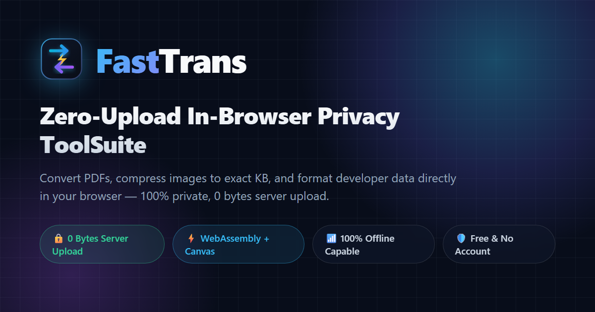

<div align="center">

  

  # FastTrans Privacy ToolSuite
  
  **100% Client-Side, Zero-Server-Upload Web Utilities for Developers, Creators & Privacy Advocates.**

  <p align="center">
    <a href="https://showpara.online"><strong>Explore FastTrans Live »</strong></a>
    <br />
    <br />
    <a href="https://showpara.online">🚀 Launch App</a>
    ·
    <a href="https://showpara.online/security/">🛡️ Security Whitepaper</a>
    ·
    <a href="https://github.com/chenjg123123/showpara-toolsuite/issues">🐛 Report Bug</a>
    ·
    <a href="https://github.com/chenjg123123/showpara-toolsuite/issues">💡 Request Feature</a>
  </p>

  <p align="center">
    <a href="https://showpara.online"></a>
    <a href="https://opensource.org/licenses/MIT"></a>
    <a href="https://showpara.online/security/"></a>
    <a href="https://developer.mozilla.org/en-US/docs/WebAssembly"></a>
  </p>

  <br />

  

</div>

<br />

---

## ⚡ The FastTrans Difference

Traditional online converters (**Smallpdf**, **iLovePDF**, **TinyWow**) require you to upload private contracts, tax returns, and passport photos to third-party cloud servers. Once uploaded, you forfeit control over where your sensitive documents are cached, indexed, or stored.

**FastTrans redefines web utilities with client-side isolation:**

| Feature | ☁️ Traditional Cloud Converters | 🔒 FastTrans Privacy Suite |
|---|:---:|:---:|
| **Server File Upload** | ⚠️ Yes (Sent to remote servers) | 🛡️ **0 Bytes (Never leaves your device)** |
| **Data Processing Location** | Remote Cloud Data Centers | **Local Browser Memory (WASM / Canvas)** |
| **Offline Capability** | ❌ Fails without internet | ✅ **100% Functional completely offline** |
| **File Storage Risk** | Leaks, data hoarding, retention | 🛡️ **Physically Impossible to leak** |
| **Speed & Latency** | Slow (Upload + Queue + Download) | ⚡ **Instantaneous (Zero network latency)** |
| **Paywalls & Quotas** | Strict daily limits & subscriptions | 🎁 **100% Free Forever, No Account Needed** |

<br />

---

## 🛠️ Complete Tool Matrix

Every utility below runs isolated in your browser tab. Click any tool to launch directly:

### 📑 PDF Productivity Suite
| Tool | Core Capability | Direct Link |
|---|---|:---:|
| **Compress PDF** | Target exact byte ceilings (1MB, 2MB, 500KB) for visa & email | [Launch Tool »](https://showpara.online/compress-pdf/) |
| **Compress PDF to 1MB** | Dedicated Schengen visa, USCIS & email portal compressor | [Launch Tool »](https://showpara.online/compress-pdf-to-1mb/) |
| **Compress PDF to 2MB** | State court e-filing, legal briefs & government job compressor | [Launch Tool »](https://showpara.online/compress-pdf-to-2mb/) |
| **PDF to JPG** | High-DPI page extraction directly to lossless JPEG/PNG | [Launch Tool »](https://showpara.online/pdf-to-jpg/) |
| **PDF Merge** | Drag, visual reorder, and combine multiple PDF documents | [Launch Tool »](https://showpara.online/pdf-merge/) |
| **PDF Split** | Extract specific page ranges or burst into standalone PDFs | [Launch Tool »](https://showpara.online/pdf-split/) |
| **Images to PDF** | Convert multi-format photos into standardized A4/Letter PDFs | [Launch Tool »](https://showpara.online/images-to-pdf/) |
| **PDF to Word** | Faithful layout extraction into editable `.docx` containers | [Launch Tool »](https://showpara.online/pdf-to-word/) |

### 🎯 Target-KB Image Compressors
*Engineered specifically for strict government, exam (UPSC/SSC), and visa (DS-160/Schengen) portals:*
| Preset | Target Constraint & Use Case | Direct Link |
|---|---|:---:|
| **Exact 20KB** | Government signature & thumbprint submissions | [Launch Tool »](https://showpara.online/compress-image-to-20kb/) |
| **Exact 50KB** | Official passport photos & civil exam registration | [Launch Tool »](https://showpara.online/compress-image-to-50kb/) |
| **Exact 100KB** | E-commerce hero images, Shopify catalog assets | [Launch Tool »](https://showpara.online/compress-image-to-100kb/) |
| **Exact 200KB** | US Visa (DS-160) & European Schengen upload quotas | [Launch Tool »](https://showpara.online/compress-image-to-200kb/) |

### 💻 Developer & Data Powerhouse
| Tool | What It Does | Direct Link |
|---|---|:---:|
| **JSON Formatter** | Tree-view parsing, syntax highlighting, and minification | [Launch Tool »](https://showpara.online/json-formatter/) |
| **JSON to YAML** | Bi-directional round-trip converter with 2-space styling | [Launch Tool »](https://showpara.online/json-to-yaml/) |
| **CSV to JSON** | Instant client-side tabular data transformer | [Launch Tool »](https://showpara.online/csv-to-json/) |
| **JWT Decoder** | Decode headers, payload claims & timestamps locally | [Launch Tool »](https://showpara.online/jwt-decoder/) |
| **UUID Generator** | Cryptographically secure UUID v4 and millisecond-sorted v7 | [Launch Tool »](https://showpara.online/uuid-generator/) |
| **Regex Tester** | Real-time pattern matching with capture group breakdown | [Launch Tool »](https://showpara.online/regex-tester/) |
| **Text Diff Viewer** | Side-by-side split & unified character-level diffing | [Launch Tool »](https://showpara.online/text-diff/) |

<br />

---

## 🏗️ Technical Architecture

FastTrans guarantees zero egress bandwidth on user data. Here is how your files are handled:

```
[ Your Local File ]
        │
        ▼  (HTML5 Drag & Drop / FilePicker)
[ Browser Memory Sandbox ] 
        │
        ├──▶ WebAssembly (libheif / pdf-lib)
        ├──▶ HTML5 Canvas (Binary-Search Adaptive Compression)
        └──▶ Pure JavaScript (AST Parsers & Stream Generators)
        │
        ▼  (URL.createObjectURL / Memory Blob)
[ Local Instant Download ]
```

> **Verification:** Press `F12` to open DevTools, switch to the **Network** tab, and convert any 50MB PDF or photo. You will observe exactly **0 HTTP POST/PUT requests** containing your file.

---

## 🔒 Security & Privacy Whitepaper

We believe privacy policies should be provable by code, not just legal promises. Read our full technical security model:
👉 **[https://showpara.online/security/](https://showpara.online/security/)**

---

## 🤝 Contributing

Contributions, issues, and feature requests are warmly welcomed!  
Feel free to check out the [issues page](https://github.com/chenjg123123/showpara-toolsuite/issues).

1. Fork the Project
2. Create your Feature Branch (`git checkout -b feature/AmazingTool`)
3. Commit your Changes (`git commit -m 'Add some AmazingTool'`)
4. Push to the Branch (`git push origin feature/AmazingTool`)
5. Open a Pull Request

---

## 📄 License

Distributed under the **MIT License**. See `LICENSE` for more information.

<div align="center">
  <sub>Built with ❤️ by <a href="https://github.com/chenjg123123">chenjg123123</a> for a faster, safer, private open web.</sub>
</div>
